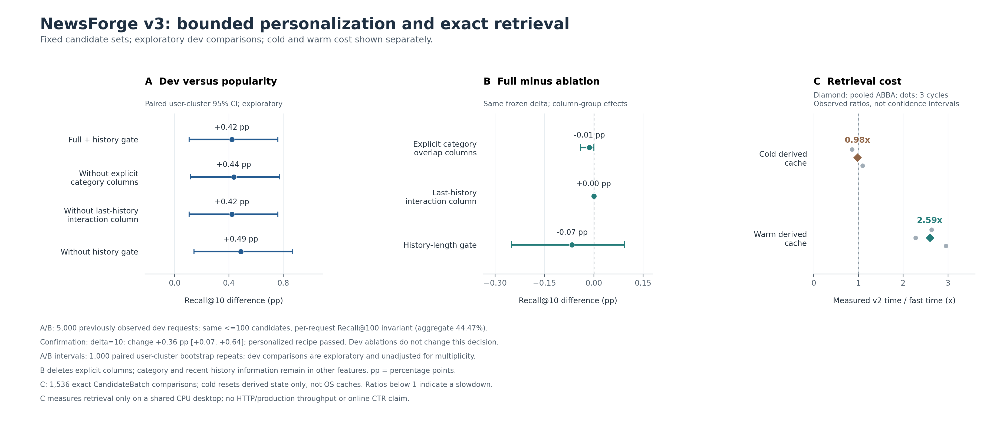
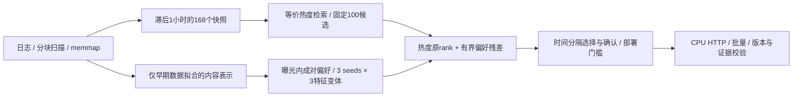

# NewsForge v3

**严格延迟反馈下的新闻推荐研究、受约束个性化与 CPU 服务。**

在 MIND-large 的 **260.9 万曝光组、9759.3 万候选记录、75.0 万匿名用户、10.4 万篇新闻**上，构建数据管线、PyTorch 双塔、时间热度、特征排序和 HTTP 服务。全部实验在无 GPU 的电脑上运行。这是独立实现的个人研究项目，未使用腾讯内部数据；参考项目与数据依据见 [选型记录](docs/PROJECT_SELECTION.md)。

v2 发现普通 HGB 重排会损害目录前十点击覆盖。v3 因此固定同一组 100 个候选，训练轻量成对偏好模型，用有界残差调整热度顺序；训练、调参、确认分别使用不同时间段，并在真实服务中执行确认门槛。v1/v2 的代码和原始证据保留，见 [v1](README_V1.md) 与 [v2](README_V2.md)。

## 本轮实测

| 项目 | 结果 | 口径 |
| --- | --- | --- |
| 目录 Recall@10 | **23.4820% → 23.9044%**；+0.4224 pp，用户簇 95% CI **[0.1066, 0.7618] pp** | 固定旧 dev 5,000 请求；1,779 → 1,811 / 7,576 个日志点击 |
| 确认门槛 | **通过**；+0.3641 pp，CI [0.0668, 0.6396] pp | 独立时间段 2,000 请求，只检验预定方案，不改选消融赢家 |
| 候选不变量 | Recall@100 **44.4694%**，3,369 / 7,576 | 所有重排方案逐请求候选集合和 R@100 相同 |
| 等价检索优化 | 热小时缓存 **2.593×**，冷派生缓存 **0.977×** | 同请求 ABBA，各三轮；1,536 个 CandidateBatch 的 9 字段逐项完全相同 |
| 真实 HTTP | 单条串行 p95 **63.20 ms**，**31.63 query/s** | 四种批量/并发配置共 768 次查询，响应所有字段与离线服务完全相同 |
| 验证 | **193 项测试、13 项 HTTP 契约检查通过** | 独立审计核验 134 个文件摘要，并从保存数组重算质量指标和部署决策 |

pp 为百分点。热缓存加速只测检索调用，不包含重排、预热或 HTTP；冷缓存没有加速。HTTP 是共享桌面本次观测，不能与旧版不同时间、不同请求样本的时延直接计算加速比。



**消融没有证明每个新增组件都有效。** 显式类别重叠列、最后历史专用交互列、历史长度门控分别相对删减方案的 R@10 增量为 −0.0132、0、−0.0660 pp，均没有稳定正收益证据；完整区间见 [实测报告](reports/V3_RESULTS.md)。`no_gate` 的 dev 点值更高，但实际服务仍使用在确认前冻结的 `full13 + gate, δ=10`，不根据 dev 换方案。

## 方法与工程



- 反馈严格满足 `source_timestamp < floor(t/3600)*3600−3600`，目录满足 `first_seen < cutoff`。历史只来自请求提供的最近最多 20 条行为，完整历史用于已读过滤。
- 固定 20,000 条早期请求，每 seed **126,660 个同曝光训练对**；非点击项放回抽 4 次并排除与正例 ID 冲突的项。三特征变体复用每 seed 的配对，标准化只估计拟合数据，L2 与优化器配置预先固定。
- `score = −original_rank + δ × n/(n+5) × mean(clip(seed_score, −1, 1))`。调参只选 δ∈{0,2,5,10}；空历史严格回退，分数并列保持原热度顺序。
- 快速热度路径缓存小时排序和成员关系，仅过滤足够长度的候选前缀，移除该路径无用的双塔编码与整库过滤；缓存容量有界并保护并发访问和资源关闭。

v2 的深度模型与独立曝光内排序研究继续保留：3 配置 × 3 seeds、各 2 个完整 epoch；相同 50 万训练行的特征消融中，三 seed 平均 nDCG@10 从 0.36996 升至 0.41501，内部选定模型在完整 376,471 曝光组上为 0.42005。这是另一项排序任务，不能与 v3 目录 Recall 混算。[v2 完整证据](reports/V2_RESULTS.md)

## 复现与证据

从 [v2 数据准备](docs/V2_REPRODUCE.md)开始，依次执行 [v3 复现流程](docs/V3_REPRODUCE.md)。正式运行前冻结的定义见 [V3_PROTOCOL.md](docs/V3_PROTOCOL.md)。原始数据、权重和逐用户数组不随源码分发；依赖锁来自本次环境，尚未完成另一台机器的冷安装验证。

```powershell
.\.venv\Scripts\python.exe -m newsforge.v3.experiment fit
.\.venv\Scripts\python.exe -m newsforge.v3.experiment tune
.\.venv\Scripts\python.exe -m newsforge.v3.experiment confirm
.\.venv\Scripts\python.exe -m newsforge.v3.experiment dev
.\.venv\Scripts\python.exe -m newsforge.v3.serve --port 8003
```

服务需已有全部匹配产物；`/docs` 提供单请求和批量接口，`/health` 返回实际模型、证据版本及时间范围。通过确认的个性化方案最早可服务 2019-11-15 00:00 源时间请求。

证据：[拟合](reports/v3/fit.json) · [调参](reports/v3/tune.json) · [确认](reports/v3/confirm.json) · [消融](reports/v3/dev.json) · [检索 ABBA](reports/v3/fast_retrieval_benchmark.json) · [HTTP](reports/v3/service_benchmark.json) · [独立审计](reports/v3/release_integrity.json) · [测试日志](reports/v3_release_unit_tests.txt) · [简历条目](docs/RESUME_CN.md)

官方 dev 已被此前版本观察，本轮是已有 benchmark 的后续研究，不是新的未见测试集。继承的热度窗口和表示也不是新确认集之外首次确定的设计。用户簇区间条件于单日反馈流；消融区间未校正多重比较。日志点击覆盖不是线上 CTR、因果收益或跨日泛化证明，首次观察时间也不等于发布时间。
