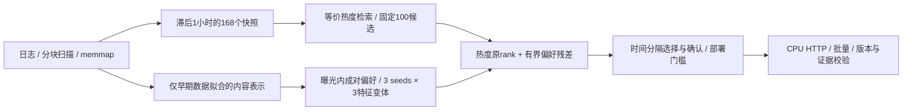

# NewsForge v3

**严格延迟反馈下的新闻推荐研究、受约束个性化与 CPU 服务。**

在 MIND-large 的 **260.9 万曝光组、9759.3 万候选记录、75.0 万匿名用户、10.4 万篇新闻**上，构建数据管线、PyTorch 双塔、时间热度、特征排序和 HTTP 服务。全部实验在无 GPU 的电脑上运行。这是独立实现的个人研究项目，未使用腾讯内部数据；参考项目与数据依据见 [选型记录](docs/PROJECT_SELECTION.md)。

v2 发现普通 HGB 重排会损害目录前十点击覆盖。v3 因此固定同一组 100 个候选，训练轻量成对偏好模型，用有界残差调整热度顺序；训练、调参、确认分别使用不同时间段，并在真实服务中执行确认门槛。v1/v2 的代码和原始证据保留，见 [v1](README_V1.md) 与 [v2](README_V2.md)。

## 原始数据重建实测（2026-10-14）

**原始数据 → 预处理 → v1/v2/v3 训练与消融 → 真实 HTTP → 独立审计已跑通。** 在独立源代码副本和 45 包隔离环境中，31 个阶段全部成功，阶段墙钟共 4 小时 44 分钟；最终验收另行通过。以下为这次重新执行的结果。[完整指标与阶段凭据](reports/raw_rebuild/RESULTS.md) · [最终验收](reports/raw_rebuild/acceptance.json) · [结果解读](reports/raw_rebuild/DISCUSSION.md)

| 项目 | 结果 | 口径 |
| --- | --- | --- |
| 曝光内排序 nDCG@10 | **0.37031 → 0.41479**；+4.4475 pp，95% CI **[3.9561, 4.8730] pp** | HGB 内容特征 → 内容与时序特征；12,000 曝光组，三 seed 均值 |
| 目录 Recall@10 | **23.4820% → 23.9044%**；+0.4224 pp，用户簇 95% CI **[0.1066, 0.7618] pp** | 固定旧 dev 5,000 请求；1,779 → 1,811 / 7,576 个日志点击 |
| 确认门槛 | **通过**；+0.3641 pp，CI [0.0668, 0.6396] pp | 独立时间段 2,000 请求，只检验预定方案，不改选消融赢家 |
| 候选不变量 | Recall@100 **44.4694%**，3,369 / 7,576 | 所有重排方案逐请求候选集合和 R@100 相同 |
| 等价检索优化 | 热小时缓存 **2.5456×**，冷派生缓存 **1.0699×** | 同请求 ABBA，各三轮；1,536 个 CandidateBatch 的 9 字段逐项完全相同 |
| 真实 HTTP | 单条串行 p95 **73.876 ms**，**29.414 query/s** | 四种批量/并发配置共 768 次查询；0 错误、0 离线差异，13 项契约通过 |
| 复现验收 | **31 阶段及最终验收通过** | 冻结工作区 256 项测试通过、2 项权限跳过；另跑 193 项重叠研究测试全部通过 |
| 独立主机 CI | **375 项测试通过，0 跳过** | GitHub Windows runner；哈希锁安装、合成/契约测试与无数据流水线计划 |

pp 为百分点。曝光内排序和目录召回是两项不同任务。检索加速只测检索调用，不包含重排、预热或 HTTP；冷态指派生缓存，历史观测为 0.977×，不主张稳定冷态收益。HTTP 是共享桌面本次观测，不能与旧版不同时间、不同请求样本的时延直接计算加速比。


图来自本次已验收的原始工作区，按原始字节发布；[图表来源与摘要](reports/raw_rebuild/v3_results.provenance.json)绑定验收和绘图输入。

**消融没有证明每个新增组件都有效。** 显式类别重叠列、最后历史专用交互列、历史长度门控分别相对删减方案的 R@10 增量为 −0.0132、0、−0.0660 pp，均没有稳定正收益证据；完整区间见 [本次实测报告](reports/raw_rebuild/RESULTS.md)。`no_gate` 的 dev 点值更高，但实际服务仍使用在确认前冻结的 `full13 + gate, δ=10`，不根据 dev 换方案。

## 外部冻结迁移（2026-10-14）

在 Adressa 的 **308.3 万条去重访问、15,000 个固定请求**上，冻结的原发布模型 HitRate@10 为 **29.5333% → 29.1600%**，差值 **−0.3733 pp，95% CI [−0.5814, −0.1598] pp**。本次不支持正向迁移；门控减轻退化，类别输入全部为 UNKNOWN，类别变体不能解释为语义贡献。128 请求慢速审计和全部请求的保存数组核验通过。此项使用原发布模型，并非本次 raw 重训模型。[外部结果、全部消融与修订记录](reports/external/adressa_v1/DISCUSSION.md)

## 方法与工程



- 反馈严格满足 `source_timestamp < floor(t/3600)*3600−3600`，目录满足 `first_seen < cutoff`。内容特征使用最近最多 20 条历史，已读过滤覆盖本次传入的全部历史；MIND 离线评估传入的是预处理后的最近 20 条，不能解释成完整原始点击史过滤。主 Recall 分母仍包含全部日志点击；更长历史过滤的效果尚未测量。
- 固定 20,000 条早期请求，每 seed **126,660 个同曝光训练对**；非点击项放回抽 4 次并排除与正例 ID 冲突的项。三特征变体复用每 seed 的配对，标准化只估计拟合数据，L2 与优化器配置预先固定。
- `score = −original_rank + δ × n/(n+5) × mean(clip(seed_score, −1, 1))`。调参只选 δ∈{0,2,5,10}；空历史严格回退，分数并列保持原热度顺序。
- 快速热度路径缓存小时排序和成员关系，仅过滤足够长度的候选前缀，移除该路径无用的双塔编码与整库过滤；缓存容量有界并保护并发访问和资源关闭。

v1 完成 3 配置 × 3 seeds、各 2 个完整 epoch，每轮 286.9 万个合格正例。内部验证选择最终轮次；五组选中第一轮，不能把训练过两轮说成最终权重均包含难负例更新。混合负例策略的 nDCG@10 下降 0.2623 pp；注意力模型的 nDCG@10 差值区间跨零。[神经消融与选轮证据](reports/raw_rebuild/V1_REBUILD.md)

v2 在内部时间窗口选择固定 epoch-2 双塔骨干，另做 HGB 曝光内排序特征消融。相同 50 万训练行下，从 15 维内容特征扩展至 22 维内容与时序特征，三 seed 平均 nDCG@10 从 0.37031 升至 0.41479；内部选定单模型在完整 **376,471 曝光组、14,085,557 个候选**上为 **0.418905**。该 HGB 用于目录重排时，R@10 却降低 10.3617 pp，因此保留了 v3 的受约束方案。[本次全部对照与区间](reports/raw_rebuild/RESULTS.md)

## 复现与证据

从 [v2 数据准备](docs/V2_REPRODUCE.md)开始，依次执行 [v3 复现流程](docs/V3_REPRODUCE.md)。正式运行前冻结的定义见 [V3_PROTOCOL.md](docs/V3_PROTOCOL.md)。原始数据、权重和逐用户数组不随源码分发；独立环境、哈希锁安装、制品导入与自动验收的入口见 [交付指南](docs/DELIVERY.md)。

本次原始重建独立复制四个已有原始 TSV 和 103 个冻结源文件，使用不继承全局第三方包的 45 包环境；完整阶段与最终验收绑定原始数据、训练模型、保存数组和真实 HTTP。验收通过不要求重现历史数值。重新计算的 SVD 参数与文本向量不是逐位一致；v3 的确认与 dev 科学汇总恰好与历史相同，不能扩展为整条流水线或模型字节一致。[数值差异分析](reports/raw_rebuild/preprocessing_comparison.json)

此前另做了冻结制品迁移与处理后数据复训：两份 GitHub 克隆、36 包环境、62 项对照、9/9 模型字节一致。它们与本次原始重建的起点不同，历史成功及失败记录均保留在 [交付复验报告](reports/DELIVERY_RESULTS.md)。独立 GitHub runner 的 [375 项 CI](reports/raw_rebuild/ci_checkpoint_selection.json)验证代码与安装，不下载正式数据或替代本地训练验收。

```powershell
.\.venv\Scripts\python.exe -m newsforge.v3.experiment fit
.\.venv\Scripts\python.exe -m newsforge.v3.experiment tune
.\.venv\Scripts\python.exe -m newsforge.v3.experiment confirm
.\.venv\Scripts\python.exe -m newsforge.v3.experiment dev
.\.venv\Scripts\python.exe -m newsforge.v3.serve --port 8003
```

服务需已有全部匹配产物；`/docs` 提供单请求和批量接口，`/health` 返回实际模型、证据版本及时间范围。通过确认的个性化方案最早可服务 2019-11-15 00:00 源时间请求。

当前证据：[原始重建结果](reports/raw_rebuild/RESULTS.md) · [执行摘要](reports/raw_rebuild/execution_summary.json) · [最终验收](reports/raw_rebuild/acceptance.json) · [结果解读](reports/raw_rebuild/DISCUSSION.md) · [简历条目](docs/RESUME_CN.md) · [面试说明](docs/V3_INTERVIEW_CN.md)。历史发布证据：[v1](README_V1.md) · [v2](reports/V2_RESULTS.md) · [v3](reports/V3_RESULTS.md)。

官方 dev 已被此前版本观察，本轮是已有 benchmark 的后续研究，不是新的未见测试集。继承的热度窗口和表示也不是新确认集之外首次确定的设计。用户簇区间条件于单日反馈流；消融区间未校正多重比较。日志点击覆盖不是线上 CTR、因果收益或跨日泛化证明，首次观察时间也不等于发布时间。
