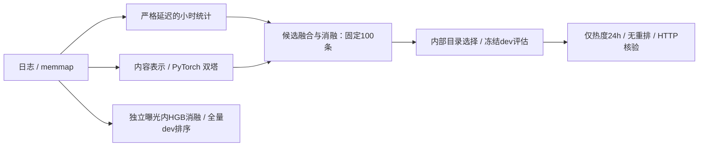
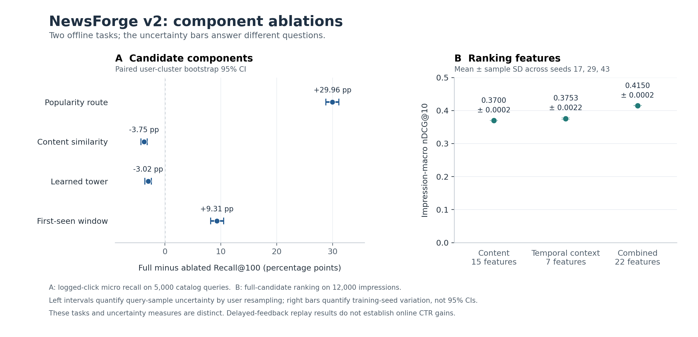

# NewsForge v2

**严格延迟反馈下的新闻推荐研究与 CPU 推理服务。**

本项目以 MIND-large 为研究对象，分别验证时间热度、内容、双塔召回与上下文排序的增量，研究曝光内排序与全目录点击覆盖之间的差异，并将离线实现接入可核验的 HTTP 服务。

实际处理 **260.9 万曝光组、9759.3 万候选记录、75.0 万匿名用户、10.4 万篇新闻**；全部实验在无 GPU 的电脑上运行。数据与代码依据见 [选型记录](docs/PROJECT_SELECTION.md)，v1 实验保留在 [README_V1.md](README_V1.md)。这是独立实现的个人研究项目，未使用腾讯内部数据。

## 架构与实验



- 请求只读取 `source_timestamp < floor(t/3600)*3600−3600` 的反馈与目录；模型和候选选择也限制在首个 dev 请求前已成熟的内部标签。
- 内容 15 维、时间上下文 7 维、合并 22 维，三方案共享 **10 万正例 + 40 万同曝光负例**，固定 HGB 容量、80 轮及 seeds 17/29/43。
- 在 6,000 个成熟请求中重选固定 epoch-2 双塔与既有 HGB，权重不重训；候选方案另用 2,000 个成熟请求选择。完整规则见 [实验协议](docs/V2_PROTOCOL.md)。

## 正式结果

| 测量 | 评估口径 | 结果 |
| --- | --- | --- |
| 目录点击覆盖 | 5,000 请求，100 候选池，全部日志点击分母 | 最终方案 `popular_only / 24h / 无重排`；R@10 **23.4820%**，R@100 **44.4694%**（3,369/7,576） |
| 冷启动覆盖 | 目录可用、非已读、训练后首次观察的点击 | R@100 **59.3921%**，分母 5,659 |
| 公平特征消融 | 12,000 曝光组，三 seed 均值 ± 样本 SD | 合并特征 nDCG@10 **0.415005 ± 0.000198** |
| 完整 dev 排序 | 376,471 曝光组、14,085,557 候选 | 内部选定 `full-seed29`：nDCG@10 **0.420052**，AUC **0.678086** |
| 真实 HTTP | batch=1、并发=1，共享 CPU 桌面 | p95 **203.833 ms**，**15.72 query/s**；0 次离线输出不一致 |

目录服务冻结为 `popular_only / 24h / 无重排`；`full-seed29` 只用于独立曝光内排序，未接入该服务。完整结果及四种 HTTP 配置见 [实测报告](reports/V2_RESULTS.md)；另有 [148 项通过测试](reports/v2_release_unit_tests.txt)与 [114 个文件摘要及指标独立审计](reports/v2/release_integrity.json)。



左图误差条为用户聚类 95% CI，右图为三 seed 样本标准差；[SVG](reports/v2/ablation.svg) 与 [数值及来源摘要](reports/v2/ablation.metadata.json) 同时提供。

| 部件 | 同请求配对对照 | 结果与判断 |
| --- | --- | --- |
| 热度 / 内容 / 双塔通道 | `full − no_popular/no_content/no_tower`，R@100 | 热度：+29.9630 [+28.7925, +31.1194] pp（支持正向贡献）；内容：-3.7487 [-4.3132, -3.1753] pp（观察到负向贡献）；双塔：-3.0227 [-3.6137, -2.4511] pp（观察到负向贡献） |
| 首次观察时效窗 | full − no_freshness，R@100 | +9.3057 [+8.1565, +10.5077] pp（支持正向贡献） |
| 合并排序特征 | full − content_only / context_only，nDCG@10 | 合并−内容 nDCG@10 +4.5047 [+4.0129, +4.9329] pp（支持正向贡献）；合并−上下文 +3.9699 [+3.5920, +4.3533] pp（支持正向贡献） |
| 候选重排 | 三种HGB分别重排 − 不重排，R@10 | 服务关闭重排；内容：-15.7075 [-16.8148, -14.6351] pp（观察到负向贡献）；上下文：-11.7872 [-12.8053, -10.8205] pp（观察到负向贡献）；合并：-10.0977 [-11.0981, -9.0665] pp（观察到负向贡献） |
| 实验路由复用 | 16 请求 × 9 方案 × ABBA | 576 批精确等价，调用减少 66.6667%；本轮两次缓存合计 9.653s、两次未缓存 12.173s，仅实验调度观测 |

配对区间按用户聚类 bootstrap；三 seed SD 单独报告。重排相同候选池不会改变 R@100，调用减少也不等于服务加速。在完整融合中加入内容的 R@100 差为 -3.7487 [-4.3132, -3.1753] pp（观察到负向贡献），复杂模型未必带来增益。

## 复现与服务

使用 Python 3.10 与 CPU，依赖见 `requirements-windows.lock`；版本锁来自本次运行环境，尚未完成独立机器冷安装验证。按 [V2_REPRODUCE.md](docs/V2_REPRODUCE.md) 执行数据准备、成熟选择、冻结评估与压测，保留原始交付证据；部分绑定使用标准 `artifacts/...` 路径。

已有匹配数据与模型产物时启动：

```powershell
.\.venv\Scripts\python.exe -m newsforge.v2.serve --selection artifacts/v2/selection.json --temporal-dir data/temporal_v2 --port 8002
```

`http://127.0.0.1:8002/docs` 提供单请求和批量接口；`/health` 返回版本与时间范围。服务拒绝越界时间，离线/HTTP共享过滤与排序规则，进程生命周期按 PID 和创建时间核验。

证据入口：[成熟骨干选择](reports/v2/backbone_matured_selection.json) · [成熟HGB选择](reports/v2/ranker_matured_selection.json) · [冻结配置](reports/v2/select.json) · [目录消融](reports/v2/catalog.json) · [排序消融](reports/v2/ranking.json) · [全量排序](reports/v2/ranking-full.json) · [HTTP](reports/v2/service_benchmark.json) · [缓存审计](reports/v2/query_cache_equivalence.json) · [简历版本](docs/RESUME_CN.md)

v2 是看过 v1 dev 后的后续研究；滚动方案使用已成熟的过去验证/dev 反馈，与冻结训练统计的信息预算不同，跨版本差异不能直接归因于同信息算法改进。首次观察时间不是发布时间，日志指标不是线上 CTR。HTTP 数值是共享桌面观测，batch延迟按整批计，RSS仅含健康后的真实服务进程。原始数据、权重和逐用户结果不随源码分发，MIND 数据遵循其独立条款。
