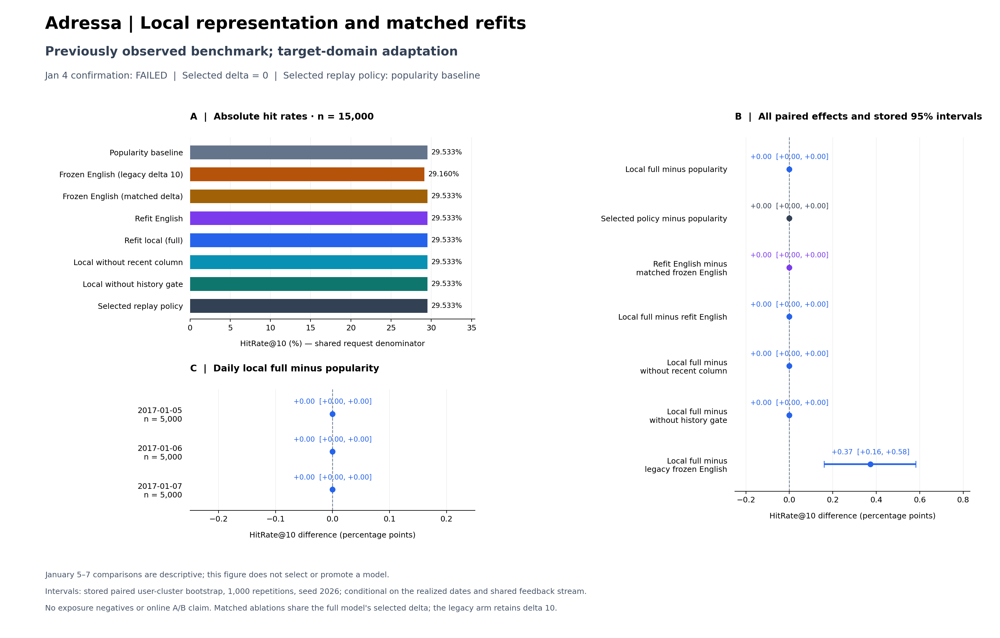

# Adressa 目标域适配：覆盖改善，未获得重排增益

本轮完成了本地字符表示、匹配重拟合、时序选择与确认、离线审计和回放 HTTP 验收，**没有选出超过热度基线的适配重排方案**。Jan 3 调参选择 `delta=0`；Jan 4 确认门未通过，实际回放策略为 popularity baseline。Jan 5–7 的 15,000 个原固定请求上，实际策略命中 **4,430 次，HitRate@10 为 29.5333%**，与原热度基线完全一致。

[最终执行验收](acceptance.json)绑定五阶段凭据、原始输入及模型摘要、独立核验、HTTP、图表与 [418 项 CI](../ci_source_freeze.json)。其中 `status=passed` 仅指执行和证据一致性通过，`recommendation_improvement_demonstrated=false` 明确记录未取得推荐收益。

这是在已知旧冻结迁移负结果之后进行的目标域适配研究。Jan 5–7 是**已经观察过的基准**；Jan 1–4 也曾用于旧实验暖机。本轮按日期保留拟合、选择和确认端点，但不能将结果称为新的未见外部测试、前瞻泛化或线上收益。设计、执行入口和完整数值分别见[协议](../../../docs/ADRESSA_ADAPTATION_PROTOCOL.md)、[运行手册](../../../docs/ADRESSA_ADAPTATION_RUNBOOK.md)及 [evaluation.json](evaluation.json)。源代码冻结提交为 `a74fecbf9ddcc1918a28abd58d23a159f6c0fd4a`。

## 选择为什么回到热度

本地主方案只在 Jan 3 的同一组 5,000 个请求上选择残差强度；其他匹配方法共同使用该 delta，没有分别调参。

| delta | Top10 命中 / 请求 | HitRate@10 | 相对 delta=0（百分点） |
|---:|---:|---:|---:|
| **0（选中）** | **1,435 / 5,000** | **28.70%** | **0.00** |
| 2 | 1,434 / 5,000 | 28.68% | −0.02 |
| 5 | 1,426 / 5,000 | 28.52% | −0.18 |
| 10 | 1,420 / 5,000 | 28.40% | −0.30 |

最小的非零强度只少命中一个请求，不能据此断言所有非零适配都存在稳定负收益；这些数值只是预定选择集上的比较。固定规则仍应选择最高命中的 delta=0，不能在看过后续结果后追加强度、改选其他变体或更换指标。

Jan 4 确认中，主方案与 baseline 都命中 **1,416 / 5,000，28.32%**；配对差为 0，95% 用户簇区间为 `[0, 0]`。`delta>0`、差值大于零和区间下界大于零三项均未满足。此时残差已经被置零，确认结果并非对两个不同排序器的强等效性证据；它记录了预定保守规则没有启用新模型。

## delta=0 使匹配消融无法识别组件贡献

**delta=0 将每个匹配方法的分数都化为 `-original_rank`。** 冻结英文匹配强度、英文重拟合、本地重拟合、去最近历史专用列、去历史门控，以及实际策略，均与热度基线逐请求同序、同分。只有保留原 delta=10 的 legacy 冻结英文方法不同。

| 方法范围 | Top10 命中 / 请求 | HitRate@10 | MRR@10 |
|---|---:|---:|---:|
| 热度基线、全部 delta=0 匹配方法、实际回放策略 | 4,430 / 15,000 | 29.5333% | 0.111776 |
| 原冻结英文 legacy，delta=10 | 4,374 / 15,000 | 29.1600% | 0.106207 |

因此，重拟合对冻结权重、本地表示对英文表示、最近历史专用列、历史门控的匹配差值均为 0，区间均为 `[0, 0]`。这来自排序公式关闭残差的结构事实，**不能解释为组件无效、真实贡献为零，或新旧表示具有相同推荐能力**。本轮固定强度消融在选中零强度后不再有组件归因能力；本轮冻结协议未设置评估后另挑非零强度的分析分支。

主方案相对 legacy 的 **+0.3733 个百分点**，配对用户簇 95% 区间 **[+0.1598, +0.5814] 个百分点**，对应 157 个请求获益、101 个请求受损、净增 56 次命中。这是**关闭旧有负向残差、回到原热度排序的收益**，不能记为本地字符模型或目标域重拟合带来的推荐增益。[旧冻结迁移负结果](../../external/adressa_v1/DISCUSSION.md)仍然成立，且其逐请求命中与倒数排名在本轮精确复现。

图中 legacy 对比的正向差值须按上述回退解释。其余零差值是 delta=0 的结果。图保留全部八个方法、七个对比和三个评估日；图的数据、脚本及 PNG/SVG 摘要见 [adaptation_results.metadata.json](adaptation_results.metadata.json)。

## 文本覆盖改善不等于排序改善

字符 TF-IDF/SVD 只用 Jan 1 23:00 UTC 之前首次出现的 **4,553 篇文章**拟合，得到 **27,307 个字符特征、96 个 SVD 维度**。20,395 篇文章中，零 TF-IDF / 零 SVD 表示从旧英文编码的 **5,064 篇（24.83%）降为 3 篇（0.0147%）**。评估候选的 1,500,000 个文章出现位置中，零文本表示从 250,271 个降为 0；最近历史的 156,788 个出现位置中，从 23,040 个降为 1。这些是按出现位置统计，不能当作不同文章或不同用户数量。

非零向量仅说明标题字符能被词表和投影覆盖，不保证捕捉用户兴趣、区分同一热度池内候选或优化下一阅读排序。本轮非零强度在选择集上没有超过热度，因而覆盖改善没有转化为被选中的重排增益。全部类别仍为相同 UNKNOWN 后缀；本轮没有修复类别字段，也不能作类别语义贡献或跨语言语义理解的结论。

Jan 2 固定抽取 30,000 个 fit 请求；其中 **10,642 个**满足非空历史、目标在原候选池且存在替代项的训练条件。每个 seed 产生 **85,136 对**，三个重拟合变体共享对应 seed 的配对身份。剔除训练配对的顺序计数为 7,397 个空历史请求、其后 11,961 个目标不在池请求，没有“无替代项”请求；这些顺序计数与允许重叠的全样本诊断不同。替代候选没有曝光记录，不是真实曝光负例。

评估仍保留全部 15,000 个请求，包括 1,945 个空历史、3,976 个目标尚不可见、1,566 个目标已读的请求；诊断可以重叠。所有方法候选集合相同，HitRate@100 均为 **7,613 / 15,000 = 50.7533%**。三日热度及实际策略分别命中 1,452、1,908、1,070 次，各自分母都是 5,000；整体是每日等额抽样结果，不是按全量访问量加权的三日指标。用户簇区间条件于这三个已实现日期和共同新闻/反馈流，不能代表未来日期或生产环境的不确定性。

## 资源记录与长时间间隔

| 离线阶段 | 实测阶段耗时（秒） | 采样最大 RSS（MiB） |
|---|---:|---:|
| prepare | 2,653.93 | 514.42 |
| fit，九份残差模型 | 9.75 | 304.35 |
| tune | 5.70 | 123.46 |
| confirm | 5.49 | 189.40 |
| evaluate，含审计及汇总 | 58.51 | 451.05 |

prepare 墙钟约 44.23 分钟；保留的进度日志中，两条相邻 `feature_cache_progress` 记录之间有 **1,961.57 秒，约 32.69 分钟**的间隔。日志不能确定这段间隔的原因，不能将其直接解释为持续 CPU 运算时间。资源监测设置为 100 ms 采样，但 prepare 仅记录 5,771 个样本，并记录到很低的系统可用内存；采样可能漏峰，同机负载也不受控。上表如实保留这些观测，不能据此宣称独占硬件性能、稳定内存上界或相对 MIND 的加速比。阶段耗时亦不包含整个项目的数据下载、原始解析、外部流程和全部验收时间。

## 回放 HTTP 验收及其边界

[HTTP 报告](http.json)中的 19 项接口契约检查全部通过；四种配置合计 **768 个测量查询、432 次 HTTP 请求**，测量及预热均无 HTTP 错误或离线/HTTP 不一致。固定 64 个样本的服务 Top10 文章身份及 float64 分数，与离线引擎和已保存评估结果精确相同。

| 每次 HTTP 请求的查询数 | 客户端并发 | 成功查询 / 秒 | 整次 HTTP 请求 p95（毫秒） |
|---:|---:|---:|---:|
| 1 | 1 | 51.66 | 35.16 |
| 8 | 1 | 107.14 | 96.09 |
| 1 | 4 | 130.22 | 44.26 |
| 8 | 4 | 218.48 | 160.92 |

每种配置复用同一组 64 个已观察请求，测量三轮；服务为单 worker、数值线程 1 的 localhost 回放，客户端每次新建连接。时延包含请求编码、连接、服务端回放和响应解码，不含客户端工作线程开始请求前的排队；批量 8 的 p95 是**整个八查询 HTTP 请求**的时延，不能除以 8 写成单查询 p95。

**实际服务只执行确认后选择的热度基线。** 上表不是神经模型或适配残差模型的推理速度，也不是生产容量保证。验收证明回退策略从离线结果到 HTTP 服务的一致性，没有改变推荐增益的负结论。

正式审计独立重建了 128 个固定请求的候选、线性评分和排序，最大分数误差为 0。撰写本解读前，又从保存排名逐请求重算全部八个方法的命中、可达率和倒数排名，核对所有匹配方法的分数/顺序恒等，并独立重抽 1,000 次用户簇 bootstrap，复现相对 legacy 的区间；图中 8/7/3 组数据及报告、脚本、图片摘要也已核对。上述复核未重新解析原始归档或重新拟合模型。工程验收通过、覆盖改善与获得推荐增益是不同结论，本轮支持前两项。
