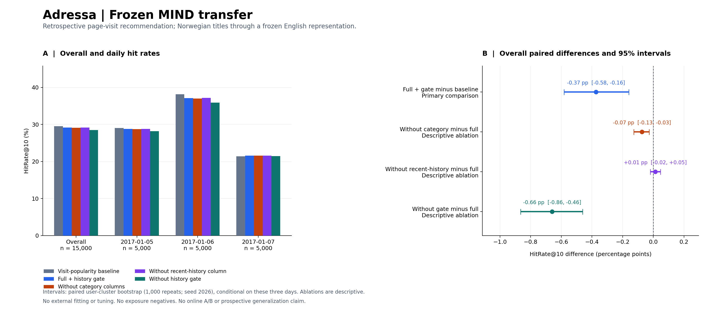

# Adressa 外部测试：结果与边界

本次冻结迁移没有通过正收益判据。15,000 个固定请求上，热度基线命中 4,430 次，`full13+gate` 命中 4,374 次；HitRate@10 从 **29.5333% 降至 29.1600%**，差值 **−0.3733 个百分点**，配对用户簇 95% 区间 **[−0.5814, −0.1598] 个百分点**。这一结果不支持将已发布 MIND 模型直接迁移到本次 Adressa 场景。

这是使用原发布 MIND 文本变换器和九个 v3 残差模型的回溯压力测试，输入为 2017 年挪威语访问事件；没有在 Adressa 上训练、调参或重选方案，也没有使用本轮原始 MIND 重建的新模型。MIND 与 Adressa 的任务、日期和日志结构不同，不能直接比较两套数据的指标水平。

## 全部消融

下表差值统一为“左侧方案减右侧方案”，单位均为百分点。消融为描述性比较，未做多重比较校正。

| 比较 | HitRate@10 差值 | 配对用户簇 95% 区间 | 可支持的解释 |
|---|---:|---:|---|
| 完整模型含门控 − 热度基线 | −0.3733 | [−0.5814, −0.1598] | 主比较为负，不支持正向迁移 |
| 去类别列 − 完整模型含门控 | −0.0733 | [−0.1269, −0.0266] | 冻结模型变体有差异，但类别输入退化，不能解释为类别语义贡献 |
| 去最近历史专用列 − 完整模型含门控 | +0.0133 | [−0.0199, +0.0467] | 区间跨零，没有稳定增益证据 |
| 去门控 − 完整模型含门控 | −0.6600 | [−0.8649, −0.4603] | 门控相对无门控减轻退化，但完整模型仍未超过基线 |

所有方法的候选集合相同，HitRate@100 均为 **7,613 / 15,000 = 50.7533%**。三日主差依次为 −0.24、−1.06、+0.18 个百分点，逐日数值及区间全部保留在 [evaluation.json](evaluation.json)。不选择其中一天作为总体结论。总体是每日等额 5,000 请求的固定样本估计；三日可抽样事件数分别为 461,222、287,001、305,828，因此它不是按原始访问量加权的全部三日流量指标。

## 输入覆盖与解释限制

归档共 10,043,269 行，其中 **6,941,278 行（69.11%）**触发 `invalid_article`，另有 18,679 行超出时间范围；得到 3,083,312 条合法事件，再去掉 505 条重复后，留下 **3,082,807 条去重有效访问、637,730 个用户、20,395 篇文章**。`invalid_article` 表示 `id` / `documentId` 缺乏可用的非空字符串，或提供了非字符串类型；现有计数不能进一步区分这些原因，不能把所有被筛除行直接认定为非文章流量。结论只覆盖适配器保留的事件。1 月 5、6、7 日各固定抽取 5,000 个请求，评估样本含 14,196 个用户。没有曝光负例，因此不计算曝光 AUC 或将命中率称为 CTR。

文章标题均非空，但 **5,064 / 20,395 = 24.83%** 的文章在冻结英文 TF-IDF/SVD 下得到零文本表示。15,000 个请求中，1,945 个没有历史，3,976 个目标在截止点不可见，1,566 个目标已经出现在完整历史中；这些请求仍保留在主分母。各诊断可以重叠，不相加解释为互斥人群。

预注册适配器只读取官方说明中的 `category` 字段。[官方字段表第 6 页](https://reclab.idi.ntnu.no/dataset/cxdataset_v5.pdf#page=6)将其类型拼作 `sting`；同表其他字符串字段也如此，而列表另标为 `list`，据此按字符串处理。全部 **3,083,312 条合法事件在类别词表映射前得到空类别**，20,395 篇文章最终均为 UNKNOWN。现有计数合并了字段缺失、空值和非字符串情形，且没有审计其他字段别名；不能将这一现象仅归因于语言或类别词表不匹配，也不能断言源文件不含任何类别信息。

所有文章采用同一个 UNKNOWN 分量，使显式类别重叠列失去类别区分能力。`no_category` 只移除两列显式类别重叠，仍保留完整向量的相似度；各变体又具有各自冻结的 MIND 权重，因此它们可以产生不同排序。本次差值不能证明类别语义有益或成功跨语言迁移。文本覆盖、类别退化、反馈及人群变化同时存在，本实验没有识别负迁移的单一原因。

## 执行、验证与修订

科学协议、原始模型和抽样规则在目标事件读取前冻结。首次准备在第 10,000,001 行触发原定行数上限，尚未抽样或产生效果指标。随后只把保护上限提高到 20,000,000 行，登记[资源修订](../../../docs/EXTERNAL_ADRESSA_RESOURCE_AMENDMENT.md)并另建目录从同一归档重跑。修订发生在部分事件已经读取之后，不能称为资源参数完全事前注册；[失败摘要](../adressa_prepare_limit_failure.json)与[重跑前记录](../adressa_resource_retry.json)均保留。模型、超参数、指标和样本选择规则没有据此改变。

独立慢速路径核验 **128 个固定请求**，候选、排序和命中完全相同，评分最大绝对误差为 0；它共享冻结的内容特征定义，并非完全独立的模型实现。[补充验收](supplemental_verification.json)又校验 68 个文件，重算全部 **15,000 个请求**保存数组的命中与倒数排名，核对分母、覆盖及摘要链。补充验收没有再次解析原归档、推理模型或重抽 bootstrap。审计 `passed` 表示一致性验证通过，不表示效果为正。

用户簇 bootstrap 为 1,000 次、固定种子 2026；同一用户跨日请求保持在同一个簇内。区间条件于三个已经实现的日期及共同反馈流，不能代表跨日期或生产保证。准备和评估阶段每 100 ms 采样的最大 RSS 分别为 194,277,376 和 296,165,376 字节，耗时分别为 2,217.14 和 174.48 秒；评估包含独立参考审计及输入校验，不能换算成纯模型推理吞吐。上述数据不是操作系统严格峰值，也不是包含下载、最终摘要和全部验证的端到端时长。机器同时承担 MIND 重训，因此不能作为独占硬件性能基准。

本次结论保留为外部负结果。没有据此改选部署模型、调整残差强度或重新解释为线上收益。原始日志、用户及文章映射、逐请求数组、权重均留在本地，Git 仅发布代码与聚合证据。
